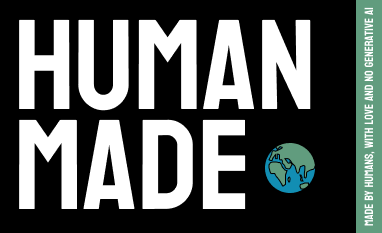

# Geriyero

Geriyero ([geriˈʎeɾo]) is a WIP sourcelike FPS shooter written in godot. It is based on the 
[Godot FPS Tutorial playlist](https://youtube.com/playlist?list=PLbuK0gG93AsHID1DDD1nt4YHcdOmJvWW1&si=U0Qo4pRHHPfNNahh)

The code here is adapted from the code from the playlist, which can be viewed at https://github.com/majikayogames/SimpleFPSController

# Name
Geriyero is an [eye-dialect](https://en.wikipedia.org/wiki/Eye_dialect) version of the spanish word guerrillero ([geriˈʎeɾo]) 
which means "a person who is a member of a guerrilla unit".

# License

This code is licensed under AGPL-3.0, the text for the license may be
found in [LICENSE](./LICENSE).

### Third Party Attributions
Portions of this code are adapted from https://github.com/majikayogames/SimpleFPSController which is licensed under CC0

